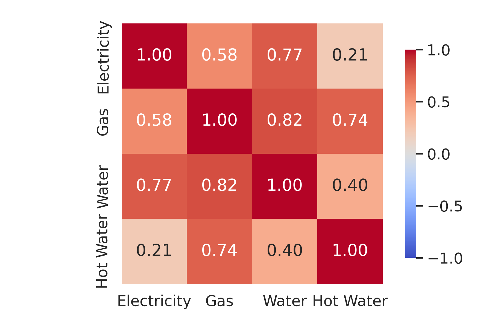
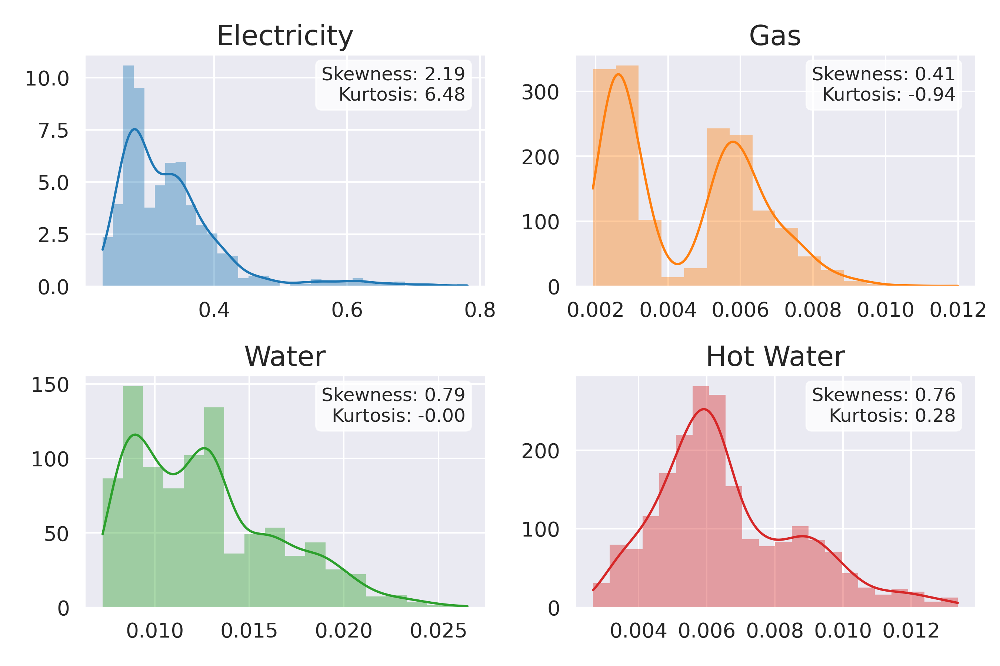
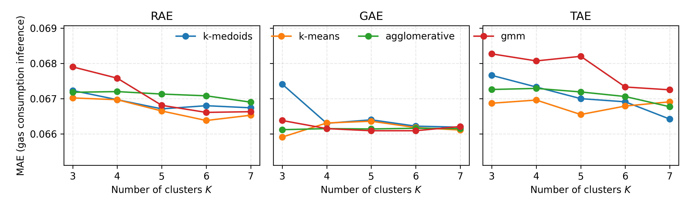
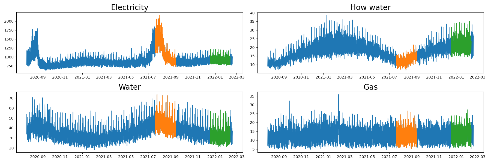

# AMI 에너지 데이터 수집 · 분산 전처리 · 소비 예측

스마트미터(AMI) 와 가정 전력 데이터를 대상으로 **데이터 수집(웹 크롤링) → 대용량 전처리(PySpark) → 군집 분석 · 시각화 → 딥러닝 예측**
까지를 한 저장소에 모았다. 마지막 단계의 결측 에너지원 추론 코드는 아래 논문의 공개 구현이다.

> Jong Seong Park, Jeong-Ha Park, Ji-Hyeok Choi, **Self-supervised inference of missing energy sources for enhancing energy consumption forecasting**,
> *Applied Soft Computing* 192 (2026) 114732. https://doi.org/10.1016/j.asoc.2026.114732
> 본 저장소 작성자(최지혁, 3저자)가 논문 실험 코드(`paper_code/`) 전체를 작성했다. 원 공개 위치: https://github.com/bigbases/Inference_Based_Load_Forecasting

## 구성

| 폴더 | 내용 | 기술 요소 |
|---|---|---|
| `data_collection/` | Weather Underground 기상 이력 크롤러 2종 (월별 요약 · 일별 관측) | Selenium headless Chrome, `pandas.read_html`, 재시도 · 재개 |
| `spark_preprocessing/` | 아일랜드 CER 스마트미터 원시 데이터(약 1.6억 행) 전처리 | PySpark, Spark SQL (CACHE TABLE · JOIN · 집계), 시간코드 복원, 결측 보간, 시간 · 기상 · 공휴일 특징 |
| `icesi/` | UCI 가정 전력 데이터 + 크롤링 기상 병합, 일 패턴 군집 → 분류 | pandas 리샘플링, t-SNE · UMAP · KMeans, XGBoost · MLP · SVM, matplotlib |
| `analysis/` | CER 가구별 부하 패턴 군집 분석과 2D · 3D 시각화 | t-SNE · UMAP, KMeans · DBSCAN · GMM, silhouette, matplotlib 3D |
| `paper_code/` | 결측 에너지원(가스 · 온수 · 수도) 자기지도 추론 → 전력 수요 예측 | PyTorch (LSTM · Transformer · GAE · MTAD-GAT), 군집 기반 추론, 민감도 분석 |
| `docker/` | GPU + PySpark 실험 컨테이너 | Docker, NVIDIA Container Toolkit, 비루트 사용자 · 읽기 전용 데이터 마운트 |

## 환경 구축

### Docker (권장, Linux GPU 서버)

```bash
bash docker/check_server.sh          # 드라이버 · docker · nvidia-ctk · 디스크 상태 확인
GPU=0 DATA=/path/to/data bash docker/run.sh
docker exec -it ami-dl bash
```

### 로컬

```bash
pip install -r requirements.txt       # Java 17 (PySpark), Chrome (Selenium) 은 별도 설치
```

## 데이터 (저장소에 포함하지 않음)

| 데이터 | 출처 | 비고 |
|---|---|---|
| UCI Individual household electric power consumption | https://archive.ics.uci.edu/dataset/235 | 1분 단위, 2006-12 ~ 2010-11 |
| CER Smart Metering Project (아일랜드, 약 6천 가구) | ISSDA 에 이용 신청 https://www.ucd.ie/issda/data/commissionforenergyregulationcer/ | 재배포 금지 |
| 기상 이력 (파리 오를리 LFPO, 섀넌 EINN) | `data_collection/` 크롤러로 직접 수집 | Weather Underground 약관상 결과 CSV 미포함 |
| 논문 실험용 다중 에너지(전력 · 가스 · 온수 · 수도) 데이터 | https://data.mendeley.com/datasets/vmgjjy3z69/3 | 12시간 단위로 리샘플링 |

## 실행 순서

```bash
# 1. 기상 데이터 수집 (Selenium)
python data_collection/weather_crawler.py --station fr/villeneuve-le-roi/LFPO \
    --start 2006-12-16 --end 2010-11-26 --out data/weather_data.csv
python data_collection/climate_crawler.py --station ie/clenagh/EINN \
    --start 2009-01-01 --end 2010-12-31 --out-dir data/raw/climate_history/ireland

# 2. CER 스마트미터 전처리 (PySpark) → data/values/H*.bin, data/master.bin
spark-submit --driver-memory 16g spark_preprocessing/cer_preprocess.py \
    --raw-dir /data/CER --out-dir data --climate-file data/raw/climate_history/ireland.bin

# 3. UCI 전력 + 기상 병합 → 일 패턴 군집 · 분류
python icesi/preprocess_uci.py --input data/household_power_consumption.txt \
    --weather data/weather_data.csv --out data/dataset.csv
python icesi/modeling.py data            # t-SNE → KMeans 군집, 군집별 일 패턴 그림

# 4. CER 부하 패턴 군집 시각화 (data/ireland_power_1h.bin 필요)
python analysis/cluster_plot_2d.py
python analysis/cluster_plot_3d.py summer tsne 3

# 5. 논문 실험 (자기지도 사전학습 → 결측 에너지원 추론 → 수요 예측)
bash paper_code/self-supervised/exp.sh
python paper_code/exp_all_infer.py
```


## 주요 설계

- **크롤러** — 동적 페이지라 Selenium 으로 렌더링 후 `read_html` 로 표를 파싱한다. 월별 페이지는 헤더 텍스트(Temperature/Humidity × Max/Min)로 열을 찾아 사이트의 단위 · 열 순서 변경에 견디게 했고(2026-11 레이아웃 기준) 실패 시 재시도한다. 일 단위 크롤러는 날짜별 pickle 로 저장해 중단 지점부터 재개한다.
- **Spark 전처리** — 원시 파일을 스키마 지정으로 읽고 참여 그룹(주거 · 소상공인)만 `CACHE TABLE` 로 메모리에 올린 뒤, 가구별로 Spark SQL 질의 → pandas 로 넘겨 30분 시간축에 정렬 · 보간한다. CER 시간코드(`DDDTT`) 복원 함수와 역변환 함수를 함께 둔다.
- **특징 공학** — 분 · 시 · 일 · 월을 sin/cos 로 주기 인코딩하고 요일 더미와 아일랜드 공휴일 플래그, 일별 기상(기온 · 이슬점 · 습도 · 풍속 · 기압 · 강수) 을 결합한다.
- **군집 기반 모델링** — 가구 일 패턴을 t-SNE/UMAP 으로 축소한 뒤 KMeans 등으로 묶고, 군집별로 모델을 따로 학습해 전체 모델과 비교한다 (`analysis/`, `icesi/modeling.py`).
- **결측 에너지원 추론(논문)** — 전력만 계측되는 건물의 가스 · 온수 · 수도 사용량을, 다중 에너지가 계측된 건물 군집에서 자기지도 인코더(TAE · GAE · MTAD-GAT) 로 추론해 예측 입력으로 보강한다.

## 시각화 (`paper_code/figures/`)

| | |
|---|---|
|  |  |
|  |  |

